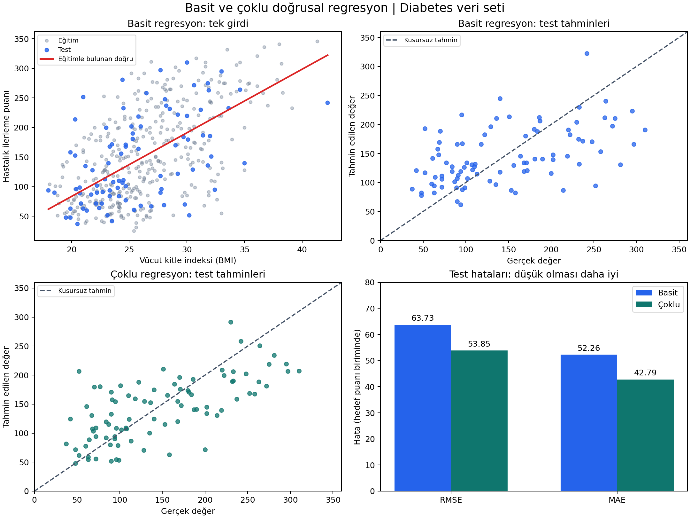

# Yapay Sinir Ağları — Basit ve Çoklu Doğrusal Regresyon

**Araştırma sorusu:** Aynı sayısal hedefi tahmin ederken tek açıklayıcı değişken yerine 10 değişken kullanmak test hatasını nasıl değiştirir?

Bu ders uygulamasında Diabetes veri seti üzerinde basit ve çoklu doğrusal regresyon karşılaştırılır. Kod, veri, eğitim/test ayrımı, katsayılar, tahminler, grafikler ve rapor birlikte paylaşılır. **Basit model yalnız BMI'ı; çoklu model 10 özelliğin tamamını kullanır. Her ikisinin hedefi de bir yıl sonraki hastalık ilerleme puanıdır.**

[](https://colab.research.google.com/github/sanlibrk/Yapay-Sinir-A-lar-A-/blob/main/regresyon_odevi.ipynb)

[Adım adım rehber](docs/adim_adim_rehber.md) · [Bilimsel rapor](docs/bilimsel_rapor.md) · [Kısa PDF raporu](rapor.pdf) · [Python kodu](regresyon.py)

## 1. Nereden başlamalıyım?

| Amacın | Açacağın dosya | Sonraki adım |
|---|---|---|
| Önce ne yapıldığını anlamak | Bu README | Veri ve sonuç bölümlerini oku. |
| Kurulum yapmadan çalıştırmak | [Colab defteri](https://colab.research.google.com/github/sanlibrk/Yapay-Sinir-A-lar-A-/blob/main/regresyon_odevi.ipynb) | **Çalışma zamanı → Tümünü çalıştır** seçeneğini kullan. |
| Her adımı açıklamasıyla takip etmek | [Adım adım rehber](docs/adim_adim_rehber.md) | Colab veya bilgisayar yolunu seç. |
| Yöntemi ve bulguları incelemek | [Bilimsel rapor](docs/bilimsel_rapor.md) | Özet → yöntem → bulgular → tartışma sırasını izle. |
| Çıktıyı yazdırmak | [PDF raporu](rapor.pdf) | Üç sayfalık özeti indir. |
| Hesaplanan sayıları görmek | [Sonuçlar](sonuclar.csv) | `Bolum=Test` satırlarını karşılaştır. |

## 2. Veri seti ve modeller

**Diabetes:** 442 kişi, 10 başlangıç özelliği ve tek bir sayısal hedef. Özellikler yaş (`age`), cinsiyet kodu (`sex`), vücut kitle indeksi (`bmi`), ortalama kan basıncı (`bp`) ve altı serum ölçümüdür (`s1`–`s6`). Hedef doğrudan kan şekeri değil, bir yıl sonraki hastalık ilerleme puanıdır. Eksik değer yoktur.

| Özellik | Basit doğrusal regresyon | Çoklu doğrusal regresyon |
|---|---|---|
| Açıklayıcı değişken sayısı | 1 | 10 |
| Girdiler | `bmi` | `age`, `sex`, `bmi`, `bp`, `s1`–`s6` |
| Model | $\hat y=b_0+b_1\,bmi$ | $\hat y=b_0+\sum_{j=1}^{10}b_jx_j$ |
| Tahmin edilen hedef | Hastalık ilerleme puanı | Aynı hastalık ilerleme puanı |
| Katsayıları bulma yöntemi | En küçük kareler | En küçük kareler |

Buradaki basit/çoklu ayrımı açıklayıcı değişken sayısını belirtir; ağ katmanı sayısını belirtmez. Bu çalışma `LinearRegression` kullanır; epoch ve öğrenme hızı ayarlanmaz.

## 3. Deney nasıl yapıldı?

1. `load_diabetes(as_frame=True, scaled=False)` ile ham özellikler alındı.
2. BMI, basit modelin tek girdisi olarak test sonuçlarına bakılmadan belirlendi.
3. `test_size=0.20, random_state=42` ile **353 eğitim ve 89 test** örneği ayrıldı. İki model aynı kişileri kullanır.
4. Her modelin katsayıları yalnız eğitim örnekleriyle `fit` edildi. Bu uygulamada standartlaştırma yapılmadı.
5. Eğitim ve test tahminleri `predict` ile elde edildi; MSE, RMSE, MAE ve R² hesaplandı.
6. Veri ayrımı, katsayılar, test tahminleri ve ölçütler CSV; grafikler PNG olarak kaydedildi.

`sample_id` satır kimliği, `split` eğitim/test bilgisidir. Bu sütunlar model girdisi değildir. Ayrım veri dosyasında da saklanır; kod aynı ayrımı sabit tohumla yeniden oluşturur.

## 4. Test sonuçları

| Model | MSE ↓ | RMSE ↓ | MAE ↓ | R² ↑ |
|---|---:|---:|---:|---:|
| Basit doğrusal regresyon | 4061,8259 | 63,7325 | 52,2600 | 0,2334 |
| Çoklu doğrusal regresyon | 2900,1936 | 53,8534 | 42,7941 | 0,4526 |

↓ Düşük olması, ↑ yüksek olması daha iyi bir sonuçtur. Tam hassasiyetli değerler ve eğitim sonuçları [sonuclar.csv](sonuclar.csv) dosyasındadır.

Bu test bölünmesinde çoklu modelin **RMSE değeri yaklaşık %15,50 daha düşüktür**:

$$\frac{63.7325-53.8534}{63.7325}\times100\approx15.50\%$$

- **MSE:** Hataların karelerinin ortalaması; büyük hatalara daha fazla ağırlık verir.
- **RMSE:** MSE'nin karekökü; hastalık ilerleme puanıyla aynı birimdedir.
- **MAE:** Mutlak hataların ortalaması; çoklu modelde yaklaşık 42,79 puandır.
- **R²:** Hedefteki değişimin açıklanmasını özetler. **Yüzde doğruluk değildir** ve negatif olabilir.

Eğitim/test RMSE değerleri basit modelde **62,08 / 63,73**, çoklu modelde **53,56 / 53,85** bulunmuştur. Bu ayrımda farklar küçüktür; farklı bölünmelerde sonuçlar değişebilir. Tek bölünme kullanıldığı için istatistiksel anlamlılık veya genel üstünlük iddiası kurulmaz. Katsayılar nedensel etki kanıtlamaz.

## 5. Grafikler ne gösteriyor?



- **Üst sol:** BMI ile hedefin ilişkisi ve yalnız eğitim verisinden öğrenilen doğru.
- **Üst sağ / alt sol:** İki modelin testteki gerçek ve tahmin değerleri. Kesikli köşegen kusursuz tahmini gösterir.
- **Alt sağ:** Test RMSE ve MAE karşılaştırması; daha alçak sütun daha düşük hatadır.

Basit modelin eğitimden bulunan denklemi:

```text
Tahmin = -131.8738 + 10.7628 × BMI
```

Çoklu modelin bütün katsayıları [katsayilar.csv](katsayilar.csv) dosyasında bulunur.

## 6. Nasıl çalıştırırım?

### En kısa yol: Google Colab

1. Üstteki **Google Colab'da aç** düğmesine bas.
2. **Çalışma zamanı → Tümünü çalıştır** seçeneğini kullan.
3. Altı kod hücresinin sonuçlarını ve grafiği incele. Veri setini ayrıca yüklemen gerekmez.

Colab'da yaptığın değişiklikler bu depoya otomatik yazılmaz. Dosyaları indirme ve hücreleri anlama adımları [ayrıntılı rehberdedir](docs/adim_adim_rehber.md).

### Bilgisayarda çalıştırma

Python **3.11 veya üstü** kurulu olmalı. Terminalde:

```bash
git clone https://github.com/sanlibrk/Yapay-Sinir-A-lar-A-.git
cd Yapay-Sinir-A-lar-A-
python -m pip install -r requirements.txt
python regresyon.py
```

Windows'ta `python` komutu tanınmıyorsa `py`; macOS/Linux'ta gerekiyorsa `python3` kullan. Git kurulu değilse **Code → Download ZIP** ile indirip arşivi aç; terminali `regresyon.py` dosyasının bulunduğu klasörde aç. Sanal ortam kurulumu ve sık karşılaşılan hatalar [rehberde](docs/adim_adim_rehber.md) açıklanır.

Kod CSV ve PNG çıktılarını kendi bulunduğu klasöre yazar. Notebook bu dosyaları notebook çalışma dizinine yazar. PDF ve Markdown raporlar önceden hazırlanmıştır; kod bunları yeniden üretmez.

## 7. Dosya haritası

```text
.
├── README.md                    # Projeye giriş, sonuç ve çalışma yolu
├── regresyon.py                 # Tek komutla çalıştırılabilir uygulama
├── regresyon_odevi.ipynb         # Açıklamalı, çıktıları kayıtlı notebook
├── requirements.txt             # Deneyde kullanılan paket sürümleri
├── diabetes_veri_seti.csv        # Ham özellikler, hedef ve eğitim/test bilgisi
├── sonuclar.csv                 # Eğitim ve test hata ölçümleri
├── katsayilar.csv               # Sabit terimler ve özellik katsayıları
├── test_tahminleri.csv           # Testte gerçek değer, tahmin ve artıklar
├── regresyon_grafikleri.png     # Dört panelli karşılaştırma
├── rapor.pdf                    # Yazdırılabilir kısa rapor
└── docs/
    ├── adim_adim_rehber.md      # Başlangıç seviyesinde uygulama rehberi
    ├── bilimsel_rapor.md        # Amaç, yöntem, bulgular ve tartışma
    └── deney_ortami.json        # Çalıştırılan Python/paket sürümleri ve ayarlar
```

`test_tahminleri.csv` içindeki artık, **gerçek değer − tahmin** olarak tanımlanır. Pozitif artık eksik tahmin, negatif artık fazla tahmin anlamına gelir.

Deneyin Python/paket sürümleri ve ayarları [deney_ortami.json](docs/deney_ortami.json) dosyasında; dosya bütünlüğü için SHA-256 özetleri [SHA256SUMS](SHA256SUMS) dosyasındadır.

## 8. Kaynaklar

1. [scikit-learn — Diabetes veri seti](https://scikit-learn.org/stable/datasets/toy_dataset.html#diabetes-dataset).
2. [scikit-learn — LinearRegression](https://scikit-learn.org/stable/modules/generated/sklearn.linear_model.LinearRegression.html).
3. [Özgün veri sayfası](https://www4.stat.ncsu.edu/~boos/var.select/diabetes.html).
4. Efron, B., Hastie, T., Johnstone, I. ve Tibshirani, R. (2004). *Least Angle Regression*. The Annals of Statistics, 32(2), 407–499. [doi:10.1214/009053604000000067](https://doi.org/10.1214/009053604000000067).
