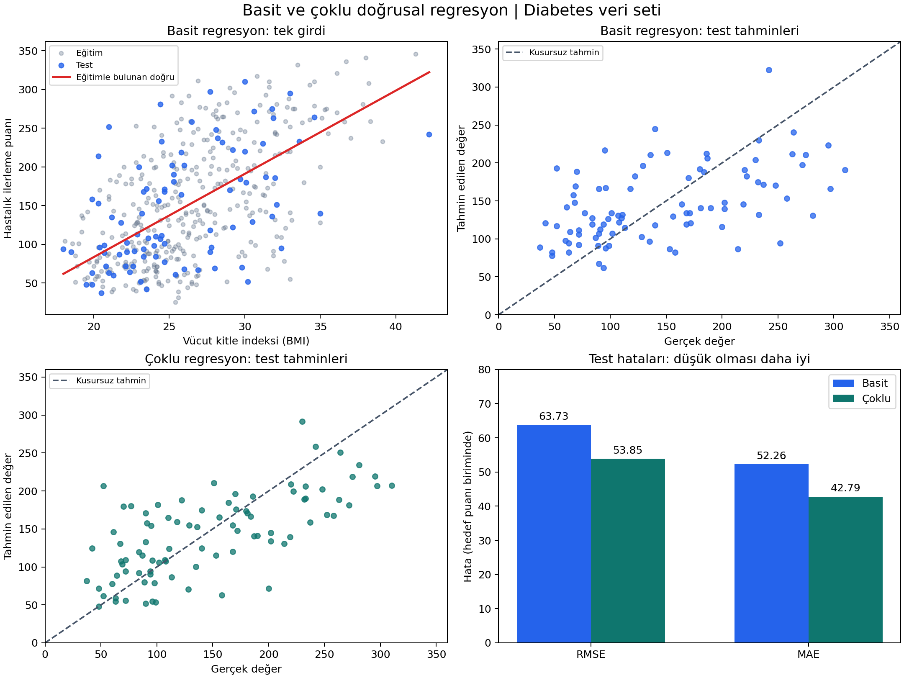

# Diabetes veri setinde basit ve çoklu doğrusal regresyonun tahmin hatalarının karşılaştırılması

Bu çalışma, Yapay Sinir Ağları dersi kapsamında regresyon modellerinin kurulmasını, eğitilmesini ve hata ölçüleriyle değerlendirilmesini göstermek amacıyla hazırlanmış bir ders uygulamasıdır. İncelenen yöntemler basit ve çoklu **doğrusal regresyondur**; burada basit/çoklu ayrımı girdi değişkenlerinin sayısını ifade eder. Kullanılan modeller tek veya çok katmanlı yapay sinir ağı değildir.

## Özet

Bu araştırmada, tek açıklayıcı değişken kullanan basit doğrusal regresyon ile on açıklayıcı değişken kullanan çoklu doğrusal regresyonun tahmin performansları karşılaştırılmıştır. Scikit-learn kütüphanesindeki Diabetes veri setinde 442 gözlem ve 10 başlangıç özelliği bulunmaktadır. Hedef, başlangıç ölçümlerinden bir yıl sonraki hastalık ilerlemesinin sayısal ölçümüdür. Basit modelde önceden belirlenen vücut kitle indeksi, çoklu modelde ise bütün özellikler kullanılmıştır. Her iki model aynı 353 eğitim ve 89 test gözlemi üzerinde değerlendirilmiştir. Modeller en küçük kareler yöntemiyle eğitilmiş; ortalama karesel hata, kök ortalama karesel hata, ortalama mutlak hata ve belirleme katsayısı hesaplanmıştır. Test RMSE değeri basit modelde 63.7325, çoklu modelde 53.8534 bulunmuştur. Çoklu modelin RMSE değeri bu bölünmede yaklaşık %15.50 daha düşüktür. Sonuçlar, bu veri ve deney düzeninde birden fazla girdinin tahmini iyileştirdiğini göstermektedir. Bununla birlikte, tek eğitim/test bölünmesi ve sınırlı örneklem nedeniyle genel üstünlük veya nedensellik sonucu çıkarılmamıştır.

**Anahtar kelimeler:** basit doğrusal regresyon, çoklu doğrusal regresyon, Diabetes, tahmin hatası, en küçük kareler, model değerlendirme.

## 1. Giriş ve araştırma sorusu

Regresyon, sayısal bir hedef değişkenin gözlenen özelliklerden tahmin edilmesini amaçlar. Basit doğrusal regresyonda bir açıklayıcı değişken, çoklu doğrusal regresyonda birden fazla açıklayıcı değişken kullanılır. Her iki durumda da bu çalışmanın çıktısı tek bir sayısal tahmindir. Değişken sayısını artırmak, modelin eğitim verisini daha iyi açıklamasına yardımcı olabilir; ancak yeni gözlemlerde daha düşük hata elde edileceği ayrıca değerlendirilmelidir.

Araştırma sorusu şu şekilde belirlenmiştir: **Diabetes veri setinde bir yıl sonraki hastalık ilerlemesi puanını tahmin ederken, yalnız BMI kullanılması yerine on özelliğin birlikte kullanılması test hatalarını azaltır mı?** Karşılaştırmanın ölçütü eğitim verisine uyumdan çok, modelin eğitimde görmediği test gözlemlerindeki tahmin performansıdır. Araştırma, özelliklerin hastalığa neden olup olmadığını incelememektedir.

## 2. Veri ve değişkenler

Scikit-learn içindeki Diabetes veri seti 442 kişiye ait 10 başlangıç özelliği içerir [1]. Veriler `load_diabetes(as_frame=True, scaled=False)` çağrısıyla alınmıştır. Böylece kütüphanenin varsayılan olarak sunduğu, bütün veri üzerinden ölçeklenmiş özellikler yerine ham özellik değerleri kullanılmıştır. Hedef değişken dönüştürülmemiştir.

| Değişken | Açıklama | Basit model | Çoklu model |
|---|---|:---:|:---:|
| `age` | Yaş | — | ✓ |
| `sex` | Sayısal kodla gösterilen cinsiyet | — | ✓ |
| `bmi` | Vücut kitle indeksi | ✓ | ✓ |
| `bp` | Ortalama kan basıncı | — | ✓ |
| `s1` | Toplam serum kolesterolü | — | ✓ |
| `s2` | Düşük yoğunluklu lipoprotein | — | ✓ |
| `s3` | Yüksek yoğunluklu lipoprotein | — | ✓ |
| `s4` | Toplam kolesterol / HDL oranı | — | ✓ |
| `s5` | Serum ölçümü; belgede olası log-trigliserit düzeyi | — | ✓ |
| `s6` | Kan şekeri ölçümü | — | ✓ |

**Hedef değişken**, bir yıl sonraki hastalık ilerlemesinin sayısal ölçümüdür; kan şekeri değeri değildir. Kan şekeri, `s6` adıyla girdiler arasında yer alır. Basit modelin BMI değişkeni deney öncesinde belirlenmiş; test sonuçlarına bakılarak seçilmemiştir. Kullanılan veri ve bölünme bilgisi [diabetes_veri_seti.csv](../diabetes_veri_seti.csv) dosyasında bulunmaktadır.

## 3. Yöntem

### 3.1. Deney düzeni

Gözlemler `train_test_split(test_size=0.20, random_state=42)` ile yaklaşık %80 eğitim ve %20 test olarak ayrılmıştır. Yuvarlama nedeniyle eğitim kümesi 353, test kümesi 89 gözlem içermektedir. Her iki modelde de aynı kişilere ait gözlemler aynı kümeye atanmıştır. Bu düzen, modellerin farklı zorluktaki test kümeleriyle karşılaştırılmasını önler.

Modellerin `fit` işlemi yalnız eğitim örnekleriyle yapılmıştır. Satırları izlemek için eklenen `sample_id` ve kümeyi belirten `split` sütunları girdilere dahil edilmemiştir. Test hedefleri model eğitiminde veya özellik seçiminde kullanılmamıştır. Böylece bu adımlarda eğitim/test veri sızıntısı önlenmiştir. Bu deneyde standartlaştırma uygulanmamış; doğrusal regresyon ham özelliklerle kurulmuştur.

### 3.2. Model tanımları ve eğitim

Basit doğrusal regresyonun gözlem modeli şöyledir:

$$
y_i = \beta_0 + \beta_1\,\mathrm{BMI}_i + \varepsilon_i.
$$

Burada $y_i$ hedef puanını, $\beta_0$ sabit terimi, $\beta_1$ BMI katsayısını ve $\varepsilon_i$ modelin açıklamadığı bileşeni gösterir. Eğitim verisinden tahmin edilen denklem:

$$
\widehat{y}_i = -131.8738 + 10.7628\,\mathrm{BMI}_i.
$$

Çoklu doğrusal regresyonda aynı hedef on girdiden tahmin edilir:

$$
y_i = \beta_0 + \sum_{j=1}^{10}\beta_j x_{ij} + \varepsilon_i.
$$

Her iki model, scikit-learn `LinearRegression` sınıfıyla adi en küçük kareler yöntemi kullanılarak eğitilmiştir. Eğitimdeki amaç, gerçek değerlerle tahminler arasındaki kareli farkların toplamını en aza indirmektir:

$$
\widehat{\boldsymbol\beta}
= \arg\min_{\boldsymbol\beta}\sum_{i\in\mathrm{eğitim}}
\left(y_i-\beta_0-\sum_{j=1}^{p}\beta_j x_{ij}\right)^2.
$$

Basit modelde $p=1$, çoklu modelde $p=10$'dur. Bu uygulama sinir ağı eğitim döngüsü kullanmadığından epoch sayısı veya öğrenme hızı belirlenmemiştir. Öğrenilen katsayılar [katsayilar.csv](../katsayilar.csv) dosyasındadır.

### 3.3. Değerlendirme ölçütleri

Bir değerlendirme kümesinde $n$ gözlem, gerçek değerler $y_i$, tahminler $\widehat y_i$ ve o kümenin hedef ortalaması $\bar y$ olsun. Ölçütler aşağıdaki gibi hesaplanmıştır:

$$
\mathrm{MSE}=\frac{1}{n}\sum_{i=1}^{n}(y_i-\widehat y_i)^2,
\qquad
\mathrm{RMSE}=\sqrt{\mathrm{MSE}},
$$

$$
\mathrm{MAE}=\frac{1}{n}\sum_{i=1}^{n}|y_i-\widehat y_i|,
\qquad
R^2=1-\frac{\sum_{i=1}^{n}(y_i-\widehat y_i)^2}
{\sum_{i=1}^{n}(y_i-\bar y)^2}.
$$

MSE büyük hataları kare alma nedeniyle daha fazla cezalandırır. RMSE ve MAE hedef puanıyla aynı birimdedir. Bu üç hata ölçütünün düşük olması tercih edilir. R² ise modelin, değerlendirilen kümenin ortalamasını tahmin eden referansa göre kareli hatayı ne ölçüde azalttığını gösterir; yüksek olması tercih edilir ve negatif olabilir. **R² bir doğruluk yüzdesi değildir.**

## 4. Bulgular

[sonuclar.csv](../sonuclar.csv) dosyasından alınan eğitim ve test sonuçları aşağıdadır. Tablodaki değerler dört ondalık basamağa yuvarlanmıştır.

| Model | Küme | n | MSE | RMSE | MAE | R² |
|---|---|---:|---:|---:|---:|---:|
| Basit doğrusal regresyon | Eğitim | 353 | 3854.1127 | 62.0815 | 51.3797 | 0.3657 |
| Basit doğrusal regresyon | Test | 89 | 4061.8259 | 63.7325 | 52.2600 | 0.2334 |
| Çoklu doğrusal regresyon | Eğitim | 353 | 2868.5497 | 53.5588 | 43.4835 | 0.5279 |
| Çoklu doğrusal regresyon | Test | 89 | 2900.1936 | 53.8534 | 42.7941 | 0.4526 |

Çoklu model, bu test kümesinde bütün hata ölçütlerinde daha düşük değer vermiştir. RMSE'deki göreli azalma:

$$
100\times\frac{63.7325-53.8534}{63.7325}\approx15.50\%.
$$

Test MAE'sinin 52.2600'dan 42.7941'e düşmesi, mutlak tahmin hatasının ortalamada azaldığını göstermektedir. Test R² değerinin 0.2334'ten 0.4526'ya yükselmesi de karşılaştırmayı desteklemektedir. Bu değer, tahminlerin %45.26'sının doğru olduğu anlamına gelmez.

Eğitim ve test RMSE farkı basit modelde yaklaşık 1.6510, çoklu modelde 0.2946 puandır. Bu bölünmede büyük bir eğitim–test farkı görülmemiştir. Grafikler, basit modelin regresyon doğrusunu, testte gerçek–tahmin ilişkisini ve hata karşılaştırmasını birlikte göstermektedir. Gözlem bazında tahminler ve artıklar [test_tahminleri.csv](../test_tahminleri.csv) dosyasında sunulmuştur.

## 5. Tartışma ve sınırlılıklar

Sonuçlar, BMI dışındaki özelliklerin birlikte kullanılmasıyla bu deneyde ek tahmin bilgisi elde edildiğini düşündürmektedir. Ancak 442 gözlemden oluşan veri seti ve 89 kişilik test kümesi sınırlıdır. Yalnız bir rastgele bölünme kullanılmış; çapraz doğrulama, tekrarlı bölünmeler veya bağımsız dış veri üzerinde değerlendirme yapılmamıştır. Dolayısıyla farklı eğitim/test seçimlerinde sonuçların değişme olasılığı vardır.

Çalışmada katsayılar için p-değeri veya güven aralığı hesaplanmamış; iki model arasındaki performans farkına ilişkin istatistiksel anlamlılık testi yapılmamıştır. Raporlanan üstünlük, gözlenen test sonuçlarıyla sınırlıdır. Özellikler arasındaki korelasyon ve farklı ölçüm ölçekleri nedeniyle katsayı büyüklükleri doğrudan önem sıralaması olarak okunmamalıdır. Bir katsayının işareti veya büyüklüğü, ilgili özelliğin hastalık üzerinde nedensel etkisi olduğunu kanıtlamaz.

Doğrusal ilişki varsayımının yeterliliği, artıkların dağılımı ve olası alt gruplardaki performans ayrıca araştırılmalıdır. Kod, veri bölünmesi ve çıktılar birlikte verilerek ders uygulamasının yeniden çalıştırılması mümkün kılınmıştır.

## 6. Sonuç

Aynı eğitim ve test gözlemleri kullanıldığında, on girdili çoklu doğrusal regresyon tek girdili basit doğrusal regresyondan daha düşük test hatası üretmiştir. Test RMSE değeri yaklaşık %15.50 azalmış, R² değeri yükselmiştir. Bulgular araştırma sorusunu bu deney düzeninde olumlu yanıtlamaktadır; daha geniş bir genelleme için tekrarlı değerlendirme ve bağımsız doğrulama gereklidir.

## Kaynaklar

1. Scikit-learn geliştiricileri. *load_diabetes — Diabetes dataset*. [Kütüphane ve veri seti belgelendirmesi](https://scikit-learn.org/stable/modules/generated/sklearn.datasets.load_diabetes.html).
2. Efron, B., Hastie, T., Johnstone, I. ve Tibshirani, R. (2004). Least Angle Regression. *The Annals of Statistics*, 32(2), 407–499. [https://doi.org/10.1214/009053604000000067](https://doi.org/10.1214/009053604000000067). [Özgün çalışma ve veri kaynakları](https://hastie.su.domains/Papers/LARS/).
3. Scikit-learn geliştiricileri. *LinearRegression*. [Model ve en küçük kareler belgelendirmesi](https://scikit-learn.org/stable/modules/generated/sklearn.linear_model.LinearRegression.html).
